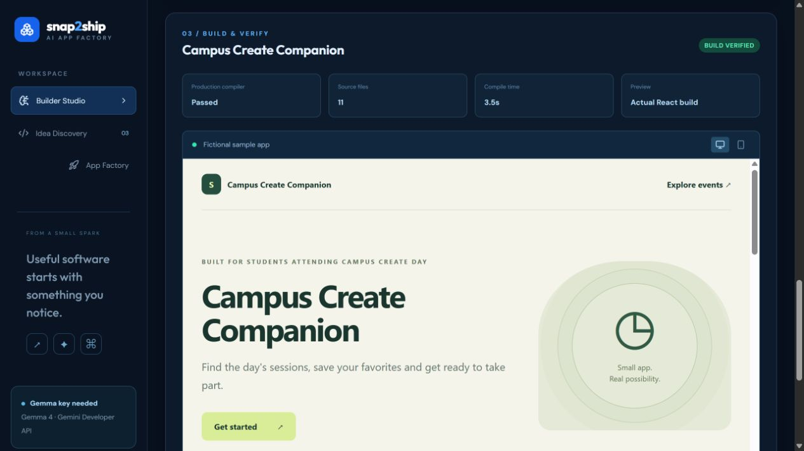
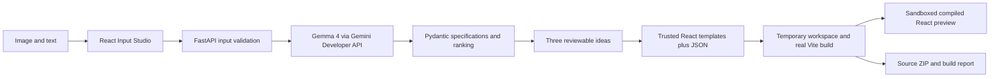

# Snap2Ship AI

### From Real-World Problems to Working Apps

Turn a campus poster, screenshot, handwritten note, or problem description into three scoped app proposals. Choose an idea to generate a functional React/Vite application, run a real production compilation, preview the compiled application, and download its source.

Built for Hacktoberfest Hack Day Delhi × SKILLOP DTU, 26 October 2026. MIT licensed.

**[Open the verified live demo](https://snap2ship-ai-api.onrender.com/)** · [Health](https://snap2ship-ai-api.onrender.com/health) · [Deployment evidence](docs/live-verification.json)

The free Render service hosts the React studio, FastAPI API and trusted compiler together. All three public sample builds passed. The service may take about a minute to wake after inactivity.

## New: photo-first glass studio

The interface is now a floating, responsive glassmorphism experience rather than a fixed dashboard. It has a browser **Take a photo** flow (live preview, confirm or retake), **Upload image**, drag and drop, source preview, a three-idea discovery board and verified build preview.

- Camera needs a secure context (**HTTPS or localhost**) and browser permission. If unavailable, Upload Image is always an option.
- Camera frames stay local until the user chooses an image and explicitly presses **Analyze with Gemma**.
- The model is `gemma-4-26b-a4b-it` through the Gemini Developer API; no custom model training is claimed.
- Backend concurrency now limits simultaneous model calls to reduce accidental quota/credit consumption.
- Read [Hackathon integration and sponsor-fit notes](docs/HACKATHON-INTEGRATIONS.md) for honest category eligibility and DigitalOcean deployment readiness.

## Implemented

- PNG, JPEG and WebP drag-and-drop input, image preview and text-only input.
- Official Google GenAI SDK integration with `gemma-4-26b-a4b-it`; an alternative Gemma model must be selected explicitly. No silent model substitution.
- Exactly three distinct proposals with bounded Pydantic specifications, audience, complexity, at most three features and transparent feasibility scores.
- Functional event tracker, checklist and information-site templates.
- Temporary build workspaces, genuine `npm run build`, compiler logs, output checks and explicit passed/failed/unverified states.
- Actual compiled React preview in a sandboxed iframe, desktop/mobile controls, source file summary and ZIP with lockfile, license and actual build report.
- A separately labelled fictional sample that makes no model request.
- GitHub Actions for backend tests, frontend compilation, three generated-app builds and the deployment container.

**Live Gemma access is unverified:** no key was supplied and the owner chose to continue without a live provider test. SDK-boundary tests use mocks. Sample proposals are curated, not live AI output. **DigitalOcean's free static frontend is prepared and awaiting account verification; no paid service was activated.** See [actual verification](docs/VERIFICATION.md).



## Quick start

Use Python 3.12+ and Node.js 22+; Node 24 is recommended. From the repository root in PowerShell:

```powershell
python -m venv .venv
.\.venv\Scripts\python.exe -m pip install -r backend\requirements-dev.txt
cd backend\template-runtime
npm ci --ignore-scripts --no-audit --no-fund
cd ..\..
cd frontend
npm ci --no-audit --no-fund
cd ..
```

Copy `backend/.env.example` to `backend/.env` and configure your Google AI Studio key locally. Never commit it. The sample and app factory work without a key.

Start the backend:

```powershell
cd backend
..\.venv\Scripts\python.exe -m uvicorn main:app --host 127.0.0.1 --port 8000
```

In another terminal:

```powershell
cd frontend
npm run dev -- --host 127.0.0.1
```

Open http://127.0.0.1:5173. Alternatively run `scripts/start-local.ps1`, which installs dependencies and starts hidden servers with logs under `.local-logs/`. On macOS/Linux, activate the Python environment and use `.venv/bin/python`.

## Try it

1. Click **Try a fictional campus poster**. This path is explicitly labelled and makes no AI call.
2. Review source observations, three proposals and scoring explanations.
3. Build the event tracker; inspect actual compiler logs and interact with its React preview.
4. Search sessions, save an event, add a preparation task and complete it.
5. Download the ZIP, extract it and run `npm ci`, `npm run build`, then `npm run preview`.

For genuine analysis, upload `examples/sample-poster.png` and click **Analyze with Gemma** after configuring a usable key. This sends your input to Google; avoid sensitive images.

| Template | Functional interactions |
| --- | --- |
| Event tracker | Search sessions, save/remove events, filter saved events, preparation checklist |
| Checklist | Add, complete, delete and filter tasks; completion progress |
| Information site | Search content, expand sections, page navigation |

Generated apps use browser localStorage when available. Embedded previews keep state only for the current preview session. There are no accounts, payments, push notifications, registration services or databases.

## Architecture



Only repository-controlled templates and package manifests are compiled. AI supplies structured data and specifications, never arbitrary executable code.

## Configuration

| Variable | Purpose |
| --- | --- |
| `GEMINI_API_KEY` | Backend-only Google AI Studio credential; optional for the curated sample |
| `GEMMA_MODEL` | Default `gemma-4-26b-a4b-it`; explicit alternative `gemma-4-31b-it` |
| `ALLOWED_ORIGINS` | Comma-separated exact frontend origins for split deployments |
| `BUILD_VALIDATION` | `true` by default; also requires installed template runtime |
| `VITE_API_URL` | Public backend URL for split deployment; `/` for same-origin Docker deployment |

Scoring rubric: MVP scope /40 + template fit /35 + source clarity /25. When present, the server computes the sum and derives GO ≥75, REVIEW ≥50, NO-GO <50. These are planning estimates, not independent market research.

## Test

```powershell
cd backend
..\.venv\Scripts\python.exe -m pytest -q
cd ..
.\.venv\Scripts\python.exe scripts\compile_samples.py
cd frontend
npm run build
cd ..
.\.venv\Scripts\python.exe scripts\audit_secrets.py
.\.venv\Scripts\python.exe scripts\check_gemma.py --all
```

The last command makes real provider requests only with a configured key. Missing credentials mean **NOT RUN**, never a passing AI test.

## DigitalOcean

[Deployment guide](docs/DIGITALOCEAN-DEPLOY.md) · [App specification](.do/app.yaml)

The authorized free route uses the [prepared static-site branch](https://github.com/rajsalonia/snap2ship-ai/tree/digitalocean-free-20261026) with the verified Render API above. DigitalOcean's creation wizard confirmed a $0/month static site but still requires owner account verification. This is prepared configuration, not a verified DigitalOcean deployment. The `main` branch's Docker web-service specification is a separate paid option and was not activated.

[Prepare a DigitalOcean deployment](https://cloud.digitalocean.com/apps/new?repo=https://github.com/rajsalonia/snap2ship-ai/tree/main) from the public repository. Review service pricing and credits before activating it. This path uses `.do/deploy.template.yaml` and does not require granting access to other GitHub repositories.

The Dockerfile builds React and serves it with FastAPI under one origin. Node remains in the runtime for trusted template compilation. No database, GPU or paid agent framework is needed. Confirm account credits and actual service pricing before creating resources. Configure secrets only in encrypted runtime settings. The app-spec file is not evidence of deployment or Gradient AI integration.

## Security and limits

Images are limited to 5 MB and 16 megapixels and verified against their declared format. Model content and array/string lengths are bounded. Validation errors omit submitted values; provider errors omit raw credentials and headers. Compiler processes receive a restricted environment without the Gemini key. Preview origin isolation is retained, closing script tags are escaped and outbound preview connections are blocked by CSP.

Builds are serialized and time-limited; API routes have per-process request limits. This prototype has no distributed limiter or authentication. Compilation verifies syntax and assets, not factual accuracy or every runtime interaction. Uploaded images are not intentionally written to disk; extracted content enters generated projects and downloads.

## Originality

Inspired by vibeDeploy's high-level discover → evaluate → build workflow. Snap2Ship uses original code and UI, image-led discovery of student/community needs, narrow templates, source-fact review and honest build evidence. It does not copy vibeDeploy source, branding or assets and is not affiliated with its creators.

[Contributing](CONTRIBUTING.md) · [MIT license](LICENSE) · [Submission pack](docs/SUBMISSION.md)
